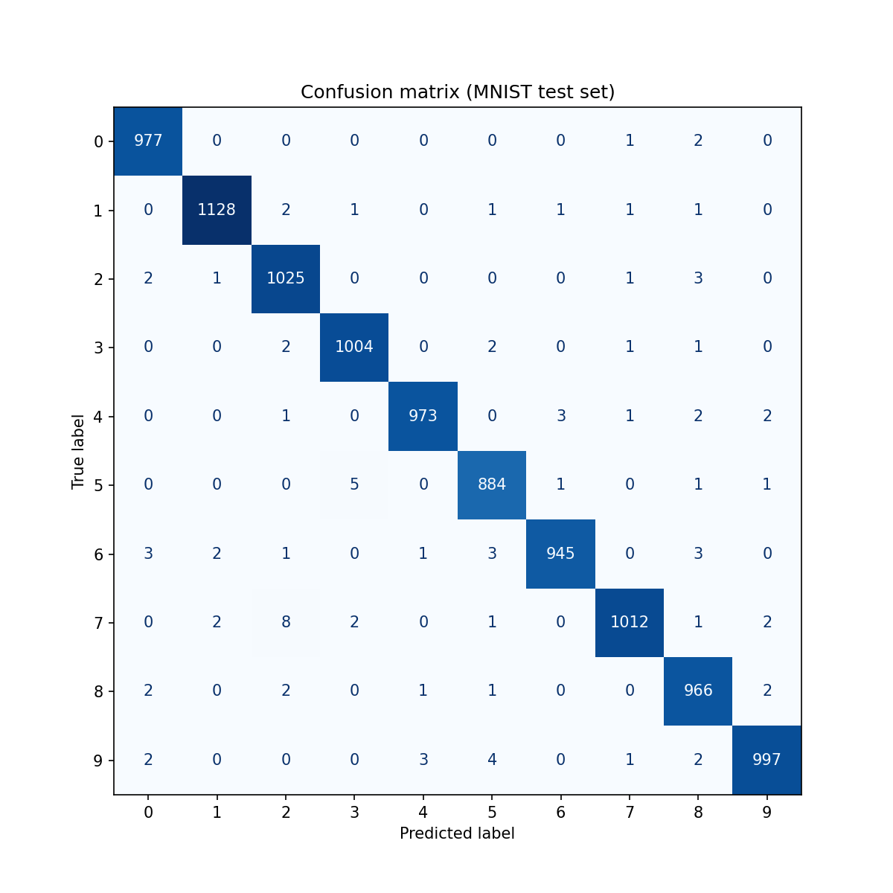
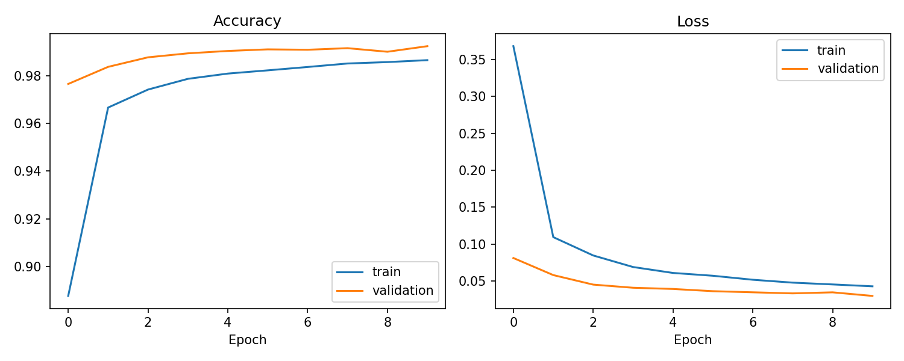
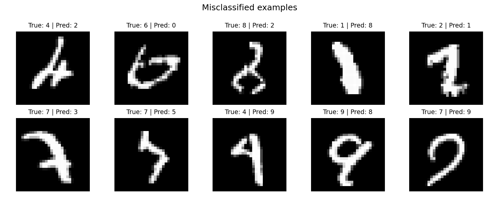

# Handwritten Digit Recognition with a CNN (MNIST)

A Convolutional Neural Network (CNN) built with TensorFlow/Keras that recognizes handwritten digits (0-9) from the MNIST dataset. The project also analyzes the model's mistakes with a confusion matrix and includes an interactive demo where you draw a digit and the model predicts it.

Digit recognition is used in real applications such as reading bank cheques or electricity, gas and water meters.

## Results

- Test accuracy: **99.11%**
- Most frequent mistakes: 8 predicted as 9 and 4 predicted as 9 (5 times each), followed by 9 predicted as 7, 9 as 5 and 6 as 5 (4 times each). The model mostly confuses digits with similar shapes.





## Model architecture

| Layer | Details |
|-------|---------|
| Conv2D | 32 filters, 3x3, ReLU |
| MaxPooling2D | 2x2 |
| Conv2D | 64 filters, 3x3, ReLU |
| MaxPooling2D | 2x2 |
| Flatten | |
| Dropout | 0.5 |
| Dense | 10 units, softmax |

Optimizer: Adam. Loss: sparse categorical cross-entropy. 10 epochs, batch size 128, 10% of the training data used for validation.

## Dataset

[MNIST](http://yann.lecun.com/exdb/mnist/): 60,000 training images and 10,000 test images of handwritten digits (28x28 pixels, grayscale). It is downloaded automatically through Keras.

## How to run

**On Google Colab (easiest):** upload `mnist_cnn_colab.ipynb` to [Google Colab](https://colab.research.google.com) and click `Runtime` → `Run all`. The last cell opens a drawing pad where you can test the model with your own handwriting.

**Locally:**

```bash
pip install -r requirements.txt
python mnist_cnn.py
```

The script trains the CNN, evaluates it, saves the training curves, the confusion matrix and examples of misclassified digits as PNG files, and saves the model as `mnist_cnn_model.keras`.

## Project structure

```
mnist_cnn_colab.ipynb   # full notebook: training, evaluation, confusion matrix, drawing demo
mnist_cnn.py            # same pipeline as a Python script (without the demo)
requirements.txt
```

## Technologies

Python, TensorFlow/Keras, NumPy, scikit-learn, Matplotlib, Pillow

## Author

Ghada Saad - AI and Electrical & Automation Engineer
